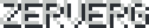

<div align="center">



<br><br>

 &nbsp;
<code>// files in, website out.</code>

<br><br>

**[ [quick start](#-quick-start) ]** &nbsp;
**[ [console](#-admin-console) ]** &nbsp;
**[ [how it works](#-how-it-works) ]** &nbsp;
**[ [api](#-api) ]** &nbsp;
**[ [hardening](#-hardening) ]** &nbsp;
**[ [license](#-license) ]**

<br>


</div>

---

```
~/zerverg $ cat README
```

**zerverg** is a small, database-free website engine written in Zig.
A website is four kinds of plain files, and nothing else:

| file     | decides                                  | lives in     |
| -------- | ---------------------------------------- | ------------ |
| `*.xml`  | the **shape**: header, sidebar, nav, footer | `layouts/`  |
| `*.css`  | the **look**: colours, fonts, borders    | `styles/`    |
| `*.html` | the **words**: posts and pages           | `posts/`     |
| `*.js`   | the **behaviour**: buttons, widgets      | `snippets/`  |

No database, no plugins, no in-browser editor. Write files with the
tools you like, push them through a REST API, roll back when you break
something.

<p align="center">
  
  <br>
  <sub><code>> the default theme, as seen on first boot</code></sub>
</p>

---

## ■ quick start

```console
$ zig build
$ ./zig-out/bin/zerverg serve --data ./site
info: fresh data directory: installing the default site
warning: DEFAULT CREDENTIALS ACTIVE: admin / admin
info: listening on http://0.0.0.0:7080     <- the site
info: listening on http://0.0.0.0:9080     <- the admin console
```

| | |
| --- | --- |
| **site** | <http://localhost:7080>, the default site *is* the manual (`/docs`, `/api`) |
| **console** | <http://localhost:9080>, log in as `admin` / `admin`, then pick a new password (forced) |

Configuration lives in `/etc/zerverg/zerverg.zon` (see
[`deploy/zerverg.example.zon`](deploy/zerverg.example.zon)). Precedence:
defaults → config file → environment (`ZERVERG_*`) → command-line flags.

> [!WARNING]
> `--dev` turns authentication **off** on both ports and binds to
> `127.0.0.1`. Never expose a dev instance to a network you don't trust.

---

## ■ admin console

<p align="center">
  
</p>

A plain, no-frills web interface over the REST API: browse posts,
layouts, styles, snippets and media, upload files, view versions and roll
back, switch the active theme. Files only, no editor, by design.

It listens on **its own port** (`admin_port`, 9080). A different port is
a different browser origin, so JavaScript snippets on the public site can
never ride the console session. Forward the site port to the internet;
keep 9080 on your LAN.

| `auth_method` | who gets in |
| --- | --- |
| `.password` *(default)* | the admin, by console login or HTTP Basic |
| `.oauth` | **Sign in with Google, GitHub** or any OpenID Connect provider (GitLab, Keycloak, Authentik, ...), limited to an allowlist |
| `.proxy` | the user an authenticating proxy (Authelia, oauth2-proxy, ...) names in a header, from `trusted_proxies` only |

### sign in with Google / GitHub

```zon
.auth_method = .oauth,
.admin_public_url = "https://admin.example.com",
.oauth_providers = .{
    .{ .name = "google", .kind = .google, .label = "Google",
       .client_id = "1234-abc.apps.googleusercontent.com",
       .client_secret_env = "ZERVERG_GOOGLE_SECRET",
       .allowed_users = .{"me@gmail.com"} },
    .{ .name = "github", .kind = .github, .label = "GitHub",
       .client_id = "Ov23li...",
       .client_secret_env = "ZERVERG_GITHUB_SECRET",
       .allowed_users = .{"id:583231"} },
},
```

Register an OAuth app with each provider, with the callback URL
`<admin_public_url>/api/v1/auth/oauth/<name>/callback`. The allowlist
is mandatory, or every Google user on earth could sign in. GitHub
entries should be `id:<number>`: login names can be renamed and then
claimed by someone else.

The password comes from `admin_password_hash` in the config (pinned; the
console can't change it), else from the console-managed `auth.json`, else
the factory `admin`, which must be changed before the API does anything
else. Forgot it? Stop the server, delete `auth.json`, start again.

---

## ■ how it works

```
request ─► layout (xml) ─► <main/> ◄─ entry (html) ◄─ <zv-entries>, media:
                │                                      expanded on render
                ▼
           style (css) + snippets (js) ─► page
```

### data directory

```
/var/lib/zerverg/
├── layouts/<name>/<version>.xml + HEAD    versioned, rollback-able
├── styles/<name>/<version>.css  + HEAD
├── snippets/<name>/<version>.js + HEAD
├── posts/<slug>.html                      posts and pages
├── media/<file>                           images, video
├── site.json                              title, active layout/style/snippets
└── auth.json                              console-managed password (0600)
```

Back it up with `tar`. Version it with `git`. Every write is atomic.

### a layout

```xml
<layout kind="sidebar-right" favicon="media:logo.svg">
  <header>
    <logo src="media:logo.svg" size="48"/>
    <site-title/>
    <tagline>notes from the terminal</tagline>
    <nav><link href="/">home</link><page-links/></nav>
  </header>
  <main/>
  <sidebar>
    <section title="search"><search/></section>
    <section title="recent"><recent-posts count="5"/></section>
  </sidebar>
  <footer><text>(c) me</text></footer>
</layout>
```

Layouts are validated on upload against a fixed vocabulary; each
component renders with a `zv-*` class for the stylesheet to target.

### an entry

```html
<title>hello, world</title>
<meta name="zerverg:date" content="2026-11-15">
<meta name="zerverg:kind" content="post">      <!-- post | page -->
<meta name="zerverg:tags" content="zig,web">
<body>
  <p>Hi. </p>
</body>
```

The page with slug `index` is the home page.

---

## ■ api

Everything goes through `/api/v1`. On the console port (9080): session
cookie (password or "sign in with ..." login), HTTP Basic, or proxy headers. On
the site port (7080): HTTP Basic only, so scripts and CI can publish.

```console
$ curl -u admin:pw -X PUT --data-binary @hello.html \
       http://localhost:7080/api/v1/posts/hello
$ curl -u admin:pw -X PUT --data-binary @dark.css \
       http://localhost:7080/api/v1/styles/dark
$ curl -u admin:pw -X POST \
       "http://localhost:7080/api/v1/styles/dark/rollback?version=1"
```

| method | path | |
| --- | --- | --- |
| `POST` | `/auth/login` · `/auth/logout` · `/auth/password` | console port; `GET /auth/session` is public |
| `GET` `POST` | `/posts` | list · create (slug from meta) |
| `GET` `PUT` `DELETE` | `/posts/:slug` | raw HTML |
| `GET` · `PUT` `DELETE` | `/media` · `/media/:file` | list · raw bytes |
| `GET` `PUT` | `/site` | title, active layout / style / snippets |
| `GET` | `/{layouts,styles,snippets}` | list with current version |
| `GET` `PUT` `DELETE` | `/{kind}/:name` | `?version=N` on `GET` |
| `GET` | `/{kind}/:name/versions` | |
| `POST` | `/{kind}/:name/rollback?version=N` | |

Cookie-authenticated writes must send `X-Requested-With: zerverg`.

---

## ■ hardening

On by default, tunable in the config file:

- **bodies** are read only *after* routing and authentication, capped
  per route; `max_body_bytes` (128 MiB) is the hard ceiling
- **rate limit** 20 req/s per client, bursts of 120; IPv6 grouped by /64
- **connections** 256 total, 16 per IP, 60 s lifetime, 1000 requests each
- **logins** argon2id, lockout after 5 failures, factory password must
  be changed first, hashed session tokens, `HttpOnly` +
  `SameSite=Strict` cookies accepted on the console port only, CSRF
  header on writes
- **console isolation** separate port and origin; oauth / proxy modes
  disable password login entirely
- **sign in with ...** authorization code flow + PKCE, single-use state
  bound to the browser, nonce, ID token signature (RS256/ES256 only)
  and claims checked, mandatory allowlist, HTTPS-only providers
- **headers** CSP, nosniff, frame denial, referrer, permissions and
  cross-origin policies; HSTS + `Secure` cookies with `.https = true`
- **uploads** UTF-8 text only, layouts schema-validated, media checked
  against file signatures, scripted SVGs rejected, media streamed
- **paths** no dot segments or control bytes, 2 KiB max
- **audit** every admin change is logged as an `audit:` line

> [!NOTE]
> Behind a reverse proxy every client shares the proxy's IP. Raise the
> per-IP limits or set `rate_limit_per_s = 0`.

---

## ■ hacking

```console
$ zig build test
```

```
src/
├── main.zig  cli.zig  config.zig  routes.zig
├── http/      server, request, router, limits, headers
├── auth/      passwords, sessions, lockout, proxy headers
│   └── oauth/ sign in with Google / GitHub / OpenID Connect
├── store/     files, versioned libraries, posts, media
├── layout/    xml parser, schema, renderer
├── site/      public pages, search
├── api/       REST handlers
├── console/   the admin console (html, css, js)
└── defaults/  the first-boot site
```

House rules: functions ≤ 60 lines, lines ≤ 80 columns, `zig fmt`.

**roadmap** `[x]` admin console · `[ ]` native TLS · `[ ]` docker image

---

## ■ license

**Apache-2.0 with the Commons Clause.** See [`LICENSE`](LICENSE) and
[`NOTICE`](NOTICE).

| | |
| --- | --- |
| ✔ use it, including inside your business | ✔ read, modify, fork |
| ✔ redistribute it, modified or not | ✔ keep it free for others |
| ✘ sell it, or sell a modified version | ✘ sell hosting or support whose value is zerverg |
| ✎ keep the copyright and `NOTICE` | ✎ credit the original project |

This makes zerverg *source-available*, not OSI open source: the
no-selling condition is the one thing those licenses cannot include.

<div align="center">
<br>
<code>powered by zerverg :: no database was harmed</code>
</div>
