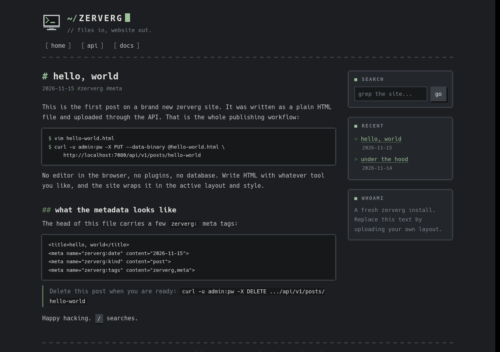
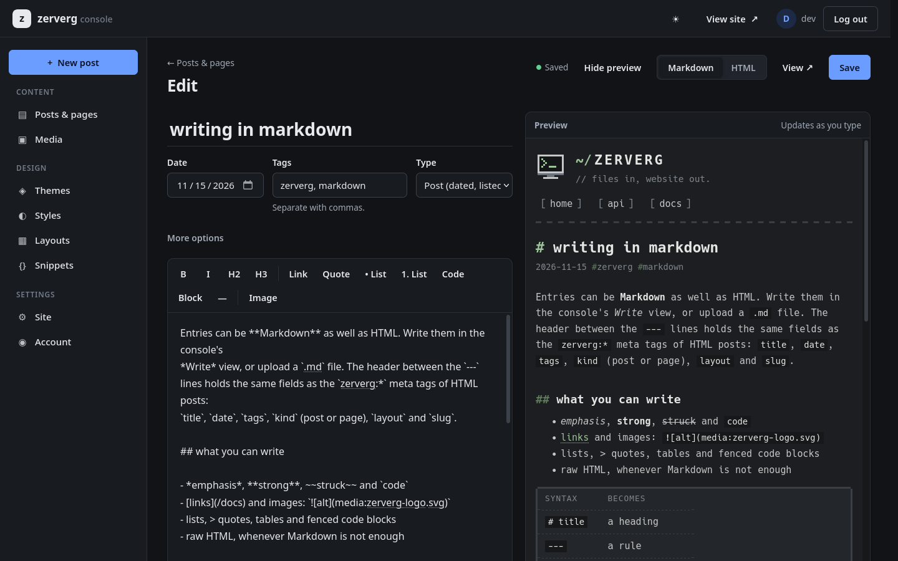

<div align="center">


<br><br>

 &nbsp;
<code>// files in, website out.</code>

<br><br>

**[ [quick start](#-quick-start) ]** &nbsp;
**[ [console](#-admin-console) ]** &nbsp;
**[ [how it works](#-how-it-works) ]** &nbsp;
**[ [api](#-api) ]** &nbsp;
**[ [hardening](#-hardening) ]** &nbsp;
**[ [contributing](#-contributing) ]** &nbsp;
**[ [license](#-license) ]**

<br>


</div>

---

```
~/zerverg $ cat README
```

**Zerverg** is a small, database-free website engine written in Zig.
A website is four kinds of plain files, and nothing else:

| file     | decides                                  | lives in     |
| -------- | ---------------------------------------- | ------------ |
| `*.xml`  | the **shape**: header, sidebar, nav, footer | `layouts/`  |
| `*.css`  | the **look**: colours, fonts, borders    | `styles/`    |
| `*.html`, `*.md` | the **words**: posts and pages   | `posts/`     |
| `*.js`   | the **behaviour**: buttons, widgets      | `snippets/`  |

No database, no plugins. Write in the browser console (Markdown or
HTML, with a live preview) or with the tools you like and push files
through a REST API. Pick one of four starter themes or restyle
everything, and roll back when you break something.

<p align="center">
  
  <br>
  <sub><code>> the default theme, as seen on first boot</code></sub>
</p>

> [!WARNING]
> **About AI usage**: I used the assistance of AI tools to complete this project.
> The design, code cleanliness rules, decisions, functionalities and such
> are all done by me, plus the code, sometimes. AI just sped up the creation
> of an otherwise months-long project. If this is a deal-breaker to you, well,
> fair enough. This is not for you.

> [!NOTE]
> **Contributions properly done will be accepted regardless of AI usage**
> (see [contributing](#-contributing)).

---

## ■ Quick start

Two ready-made ways to run it from a checkout:

| | `zig build dev` | `zig build staging` |
| --- | --- | --- |
| **for** | trying things, writing themes | rehearsing a real deployment |
| **login** | none: authentication is **off** | `admin` / `admin`, new password forced on first login |
| **transport** | plain http | https (TLS 1.3); http redirects to it |
| **listens on** | `127.0.0.1` only | all interfaces |
| **site** | <http://localhost:7080> | <https://localhost:7443> |
| **console** | <http://localhost:9080> | <https://localhost:9080> |
| **data** | `./dev-data` | `./staging-data` |
| **config** | command-line flags | [`deploy/zerverg.staging.zon`](deploy/zerverg.staging.zon) |

Both start from the default site, which *is* the manual (`/docs`,
`/api`). Delete the data directory to start over.

### Dev

```console
$ zig build dev
warning: DEVELOPMENT MODE: authentication is DISABLED.
info: public: listening on http://127.0.0.1:7080
info: admin: listening on http://127.0.0.1:9080
```

> [!WARNING]
> Dev mode turns authentication **off** on both ports. It only binds to
> `127.0.0.1`; never expose it to a network you don't trust.

### Staging

```console
$ zig build staging
warning: DEFAULT CREDENTIALS ACTIVE: admin / admin
info: tls: created a local certificate authority
warning: TLS with zerverg's LOCAL CERTIFICATE AUTHORITY.
  trust this file: staging-data/tls/ca.crt
  server certificate valid for: localhost, 127.0.0.1, ::1, mybox, mybox.local
info: public: listening on https://0.0.0.0:7443
info: admin: listening on https://0.0.0.0:9080
info: public: listening on http://0.0.0.0:7080 (redirects to HTTPS)
```

Everything works as in production: password logins with lockout,
`Secure` session cookies, HSTS, rate limits. Log in to the console as
**`admin` / `admin`**; you must choose a new password before anything
else works. Forgot it? Stop the server, delete
`staging-data/auth.json`, start again.

To reach staging from other machines, add the names or IPs they use to
`.tls_hosts` in the staging config (e.g. `"staging.lan"`,
`"192.168.1.20"`) and restart.

### Trusting the local certificate

Without a certificate file, zerverg creates its **own small certificate
authority** the first time it starts with TLS (`<data_dir>/tls/ca.crt`
and `ca.key`), and that authority signs a fresh server certificate on
every start. Browsers show a warning until you trust `ca.crt`. You only
do this once per machine: the CA stays the same across restarts and
host-name changes.

| where | how |
| --- | --- |
| Arch, Manjaro, Fedora | `sudo trust anchor staging-data/tls/ca.crt` |
| Debian, Ubuntu | `sudo cp staging-data/tls/ca.crt /usr/local/share/ca-certificates/zerverg.crt && sudo update-ca-certificates` |
| macOS | `sudo security add-trusted-cert -d -r trustRoot -k /Library/Keychains/System.keychain staging-data/tls/ca.crt` |
| Windows (admin shell) | `certutil -addstore -f ROOT ca.crt` |
| Chrome / Chromium on Linux | `certutil -d sql:$HOME/.pki/nssdb -A -t C,, -n zerverg -i staging-data/tls/ca.crt` (package `nss`) |
| Firefox (any OS) | Settings → Privacy & Security → Certificates → View Certificates → Authorities → Import `ca.crt`, tick "Trust this CA to identify websites" |
| curl | `curl --cacert staging-data/tls/ca.crt https://localhost:7443/` |

Restart the browser afterwards. To undo, remove the "zerverg local CA"
certificate the same way. Anyone holding `ca.key` can impersonate any
site to machines that trust it, so keep `ca.key` private (it is created
`0600`) and never trust a CA you didn't create yourself.

### Production

Install the binary, copy
[`deploy/zerverg.example.zon`](deploy/zerverg.example.zon) to
`/etc/zerverg/zerverg.zon` and run `zerverg serve`. Precedence: defaults
→ config file → environment (`ZERVERG_*`) → command-line flags.

For a public site, use a real certificate, e.g. from Let's Encrypt
(`certbot certonly --standalone -d example.com`):

```zon
.tls = true,
.tls_cert_file = "/etc/letsencrypt/live/example.com/fullchain.pem",
.tls_key_file = "/etc/letsencrypt/live/example.com/privkey.pem",
```

(or `ZERVERG_TLS_CERT` / `ZERVERG_TLS_KEY`). Certificates are read at
startup: restart after renewing. Built-in ACME (automatic Let's Encrypt)
is on the roadmap. Behind a TLS-terminating proxy instead, leave `.tls`
off and set `.https = true`.

---

## ■ Admin console

<p align="center">
  
  <br>
  <sub><code>> the console in dark mode: writing Markdown, previewed with the live theme</code></sub>
</p>

A web interface over the REST API. It follows your system's light or
dark setting; the ☀ / ☾ button in the top bar overrides it.

- **Write**: title, date, tags and text in one place, Markdown or HTML,
  with a live preview rendered through the real layout and stylesheet.
  Drop or paste images straight into the text.
- **Themes**: four starters, previewed on your own content before you
  switch: *Blog* (the default), *Magazine*, *Landing / shop* and
  *Newsletter*. A theme is just a layout plus a stylesheet with the
  same name, so every one of them can be edited or duplicated.
- **Design**: edit styles, layouts and snippets in the browser. Every
  save is a new version; duplicate one to experiment off the live site.
- **Media**, **site settings**, uploads, version history and rollback.

It listens on **its own port** (`admin_port`, 9080). A different port is
a different browser origin, so JavaScript snippets on the public site can
never ride the console session. Forward the site port to the internet;
keep 9080 on your LAN.

| `auth_method` | who gets in |
| --- | --- |
| `.password` *(default)* | the admin, by console login or HTTP Basic |
| `.oauth` | **Sign in with Google, GitHub** or any OpenID Connect provider (GitLab, Keycloak, Authentik, ...), limited to an allowlist |
| `.proxy` | the user an authenticating proxy (Authelia, oauth2-proxy, ...) names in a header, from `trusted_proxies` only |

### Sign in with Google / GitHub

```zon
.auth_method = .oauth,
.admin_public_url = "https://admin.example.com",
.oauth_providers = .{
    .{ .name = "google", .kind = .google, .label = "Google",
       .client_id = "1234-abc.apps.googleusercontent.com",
       .client_secret_env = "ZERVERG_GOOGLE_SECRET",
       .allowed_users = .{"me@gmail.com"} },
    .{ .name = "github", .kind = .github, .label = "GitHub",
       .client_id = "Ov23li...",
       .client_secret_env = "ZERVERG_GITHUB_SECRET",
       .allowed_users = .{"id:583231"} },
},
```

Register an OAuth app with each provider, with the callback URL
`<admin_public_url>/api/v1/auth/oauth/<name>/callback`. The allowlist
is mandatory, or every Google user on earth could sign in. GitHub
entries should be `id:<number>`: login names can be renamed and then
claimed by someone else.

The password comes from `admin_password_hash` in the config (pinned; the
console can't change it), else from the console-managed `auth.json`, else
the factory `admin`, which must be changed before the API does anything
else. Forgot it? Stop the server, delete `auth.json`, start again.

---

## ■ How it works

```
request ─► layout (xml) ─► <main/> ◄─ entry (html|md) ◄─ <zv-entries>, media:
                │                                         expanded on render
                ▼
           style (css) + snippets (js) ─► page
```

### Data directory

```
/var/lib/zerverg/
├── layouts/<name>/<version>.xml + HEAD    versioned, rollback-able
├── styles/<name>/<version>.css  + HEAD
├── snippets/<name>/<version>.js + HEAD
├── posts/<slug>.html | <slug>.md          posts and pages
├── media/<file>                           images, video
├── site.json                              title, active layout/style/snippets
└── auth.json                              console-managed password (0600)
```

Back it up with `tar`. Version it with `git`. Every write is atomic.

### A layout

```xml
<layout kind="sidebar-right" favicon="media:logo.svg">
  <header>
    <logo src="media:logo.svg" size="48"/>
    <site-title/>
    <tagline>notes from the terminal</tagline>
    <nav><link href="/">home</link><page-links/></nav>
  </header>
  <home>                                <!-- front page only -->
    <section title="latest"><post-cards count="6"/></section>
  </home>
  <main/>
  <sidebar>
    <section title="search"><search/></section>
    <section title="recent"><recent-posts count="5"/></section>
  </sidebar>
  <footer><text>(c) me</text></footer>
</layout>
```

Layouts are validated on upload against a fixed vocabulary; each
component renders with a `zv-*` class for the stylesheet to target.
`<post-cards>` shows entries as cards with their cover `image` and
`description`.

### An entry

In Markdown (`hello-world.md`):

```markdown
---
title: hello, world
date: 2026-11-15
tags: zig, web
description: One line for cards and search engines.
image: media:cover.jpg
---

Hi. 

::: note
Becomes <div class="note">: the stylesheet decides how it looks.
:::
```

or in HTML (`hello-world.html`):

```html
<title>hello, world</title>
<meta name="zerverg:date" content="2026-11-15">
<meta name="zerverg:kind" content="post">      <!-- post | page -->
<meta name="zerverg:tags" content="zig,web">
<body>
  <p>Hi. </p>
</body>
```

The page with slug `index` is the home page.

---

## ■ API

Everything goes through `/api/v1`. On the console port (9080): session
cookie (password or "sign in with ..." login), HTTP Basic, or proxy headers. On
the site port (7080): HTTP Basic only, so scripts and CI can publish.

```console
$ curl -u admin:pw -X PUT --data-binary @hello.html \
       http://localhost:7080/api/v1/posts/hello
$ curl -u admin:pw -X PUT --data-binary @dark.css \
       http://localhost:7080/api/v1/styles/dark
$ curl -u admin:pw -X POST \
       "http://localhost:7080/api/v1/styles/dark/rollback?version=1"
```

| method | path | |
| --- | --- | --- |
| `POST` | `/auth/login` · `/auth/logout` · `/auth/password` | console port; `GET /auth/session` is public |
| `GET` `POST` | `/posts` | list · create (slug from meta) |
| `GET` `PUT` `DELETE` | `/posts/:slug` | raw HTML |
| `GET` · `PUT` `DELETE` | `/media` · `/media/:file` | list · raw bytes |
| `GET` `PUT` | `/site` | title, active layout / style / snippets |
| `GET` | `/{layouts,styles,snippets}` | list with current version |
| `GET` `PUT` `DELETE` | `/{kind}/:name` | `?version=N` on `GET` |
| `GET` | `/{kind}/:name/versions` | |
| `POST` | `/{kind}/:name/rollback?version=N` | |

Cookie-authenticated writes must send `X-Requested-With: zerverg`.

---

## ■ Hardening

On by default, tunable in the config file:

- **bodies** are read only *after* routing and authentication, capped
  per route; `max_body_bytes` (128 MiB) is the hard ceiling
- **rate limit** 20 req/s per client, bursts of 120; IPv6 grouped by /64
- **connections** 256 total, 16 per IP, 60 s lifetime, 1000 requests each
- **logins** argon2id, lockout after 5 failures, factory password must
  be changed first, hashed session tokens, `HttpOnly` +
  `SameSite=Strict` cookies accepted on the console port only, CSRF
  header on writes
- **console isolation** separate port and origin; oauth / proxy modes
  disable password login entirely
- **sign in with ...** authorization code flow + PKCE, single-use state
  bound to the browser, nonce, ID token signature (RS256/ES256 only)
  and claims checked, mandatory allowlist, HTTPS-only providers
- **headers** CSP, nosniff, frame denial, referrer, permissions and
  cross-origin policies; HSTS + `Secure` cookies with `.tls` or
  `.https = true`
- **tls** native TLS 1.3 (ECDSA or RSA certificates), a local CA for
  staging (ECDSA P-256, server certs reissued each start), plaintext
  clients on the TLS ports dropped at once, handshakes bound by the
  connection lifetime
- **uploads** UTF-8 text only, layouts schema-validated, media checked
  against file signatures, scripted SVGs rejected, media streamed
- **paths** no dot segments or control bytes, 2 KiB max
- **audit** every admin change is logged as an `audit:` line

> [!NOTE]
> Behind a reverse proxy every client shares the proxy's IP. Raise the
> per-IP limits or set `rate_limit_per_s = 0`.

---

## ■ Hacking

```console
$ zig build test
```

```
src/
├── main.zig  cli.zig  config.zig  routes.zig
├── http/      server, request, router, limits, headers
├── tls/       TLS engine wrapper, certificates, local CA (x509/der/pem)
├── auth/      passwords, sessions, lockout, proxy headers
│   └── oauth/ sign in with Google / GitHub / OpenID Connect
├── store/     files, versioned libraries, posts, media
├── content/   metadata, front matter, markdown, upload checks
├── layout/    xml parser, schema, renderer
├── site/      public pages, search
├── api/       REST handlers
├── console/   the admin console (html, css, js: core, views, editors)
└── defaults/  the first-boot site
```

House rules: functions ≤ 60 lines, lines ≤ 80 columns, `zig fmt`.

**roadmap** `[x]` admin console · `[x]` native TLS · `[x]` markdown ·
`[x]` starter themes · `[ ]` ACME (Let's Encrypt) · `[ ]` RSS + sitemap ·
`[ ]` docker image

---

## ■ Contributing

Contributions are welcome, **with or without AI assistance**. How the
code was written doesn't matter; what it is does. If a change is well
done, follows this project's standards and is a good contribution
overall, it will be accepted.

The standards:

- functions ≤ 60 lines, lines ≤ 80 columns, `zig fmt`
- small modules with one clear job and descriptive names; follow the
  existing layout (see [hacking](#-hacking))
- `zig build test` passes, and new behaviour comes with tests
- no new dependencies without discussing it first
- the security defaults stay intact (origin split, CSP, validation on
  upload); a change there needs a stated reason
- console JavaScript: no frameworks and no build step; build the DOM
  with `textContent`, never `innerHTML`
- docs follow the code: README, the built-in `/docs` page and the
  example config when behaviour or settings change

For anything bigger than a fix, open an issue first so we can agree on
the approach. Whatever tools you use, you are responsible for what you
submit and should be able to explain it. Contributions are accepted
under the project's license (Apache-2.0 with the Commons Clause).

---

## ■ License

**Apache-2.0 with the Commons Clause.** See [`LICENSE`](LICENSE) and
[`NOTICE`](NOTICE).

| | |
| --- | --- |
| ✔ use it, including inside your business | ✔ read, modify, fork |
| ✔ redistribute it, modified or not | ✔ keep it free for others |
| ✘ sell it, or sell a modified version | ✘ sell hosting or support whose value is zerverg |
| ✎ keep the copyright and `NOTICE` | ✎ credit the original project |

This makes zerverg *source-available*, not OSI open source: the
no-selling condition is the one thing those licenses cannot include.

<div align="center">
<br>
<code>powered by zerverg :: no database was harmed</code>
</div>
